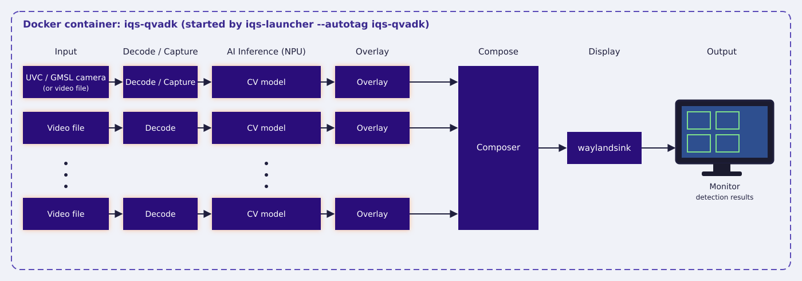

<!--
 Copyright (c) 2025 Innodisk Corp.
 
 This software is released under the MIT License.
 https://opensource.org/licenses/MIT
-->

# iQS-QVADK

QVADK is a high-throughput, multi-stream AI video pipeline built for vertical applications. It takes many 1080p video channels at once and runs several AI models on every channel, all accelerated on the Qualcomm NPU of a single Dragonwing device, so a single box can monitor many cameras in real time.

This demo runs the **PPE (Personal Protective Equipment) detection** application: it analyzes 9 video channels at the same time with a YOLO26n INT8 model running on the NPU, blurs faces to protect privacy, and displays the results live on a monitor.

>Note: The demo GIF may take some time to load. If it does not appear immediately, please wait.

<br />
<div align="center"></div>
<br />

<br />
<div align="center"></div>
<br />

# How to Deploy

## Supported Versions

Pick the iQ-Studio version that matches your platform:

| Your platform | iQ-Studio version |
| :--- | :--- |
| BSP 2.5.x (QLI 2.0) | Latest (`main`) |

- **Check BSP:** `cat /etc/innodisk/BSP-version`
- **Check QLI:** `uname -a`, then look for the `qli-<version>` field.

## What You Need?

1. At least 10 GB of free disk space
2. A monitor

## How to Start?

```bash
git clone https://github.com/InnoIPA/iQ-Studio.git
cd iQ-Studio
./install.sh
```

# How to Use

1. Download the SCRFD face detection model, which is not included in iQ-Studio. Follow [Models You Need to Provide](../../sdks/iqs-qvadk/models/README.md); it takes a few minutes.

2. Use iqs-launcher and autotag tools to automatically pull or build a compatible docker image. Run it from the iqs-qvadk directory, where the model was placed.

    ```bash
    cd tutorials/sdks/iqs-qvadk/
    iqs-launcher --autotag iqs-qvadk
    ```

3. You will see the PPE detection result on the screen.
    >Note: The demo GIF may take some time to load. If it does not appear immediately, please wait.

    

# Switch to Other Applications

Besides the PPE demo above, iqs-qvadk ships with more applications. Each one runs with a single `iqs-launcher` command. Click an application to see its command and demo:

- [**PPE with UVC camera**](../../sdks/iqs-qvadk/README.md#how-to-switch-and-run-an-application): the same PPE detection, with channel 0 showing a live UVC camera.
- [**PPE with GMSL camera**](../../sdks/iqs-qvadk/README.md#how-to-switch-and-run-an-application): the same PPE detection, with channel 0 showing a live GMSL camera.
- [**Defect detection**](../../sdks/iqs-qvadk/README.md#how-to-switch-and-run-an-application): detects defects on production line video.
- [**DMS (Driver Monitoring System)**](../../sdks/iqs-qvadk/README.md#how-to-switch-and-run-an-application): monitors the driver's face, hands, and body.

For the hardware each application needs and the full list of commands, visit this [page](../../sdks/iqs-qvadk/README.md) to learn more.
