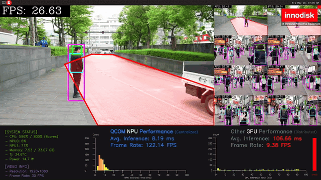
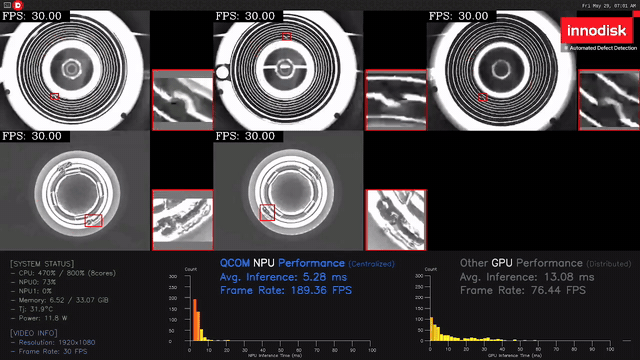
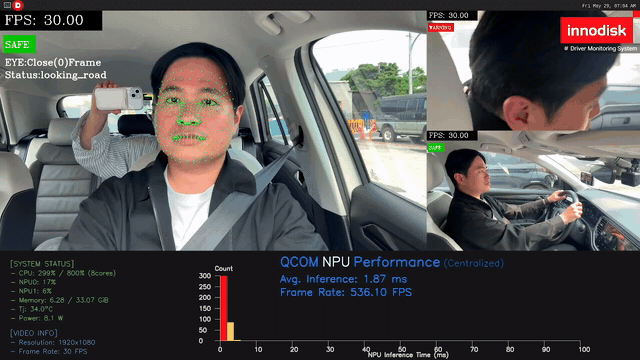
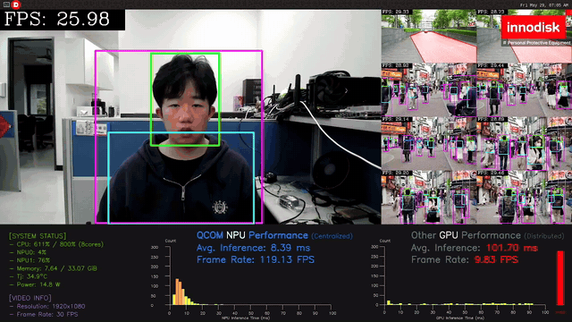

<!--
 Copyright (c) 2025 Innodisk Corp.
 
 This software is released under the MIT License.
 https://opensource.org/licenses/MIT
-->

# iQS-QVADK: How to Switch and Run the Applications

Please refer to the `tutorials/applications/iqs-qvadk` to learn how to run [iqs-qvadk](../../applications/iqs-qvadk/README.md).

In this section, we describe how to switch between the applications of iqs-qvadk and run each of them.

> Note: The latest iQ-Studio requires BSP 2.5.x (QLI 2.0). See the **Supported Versions** section of the [application tutorial](../../applications/iqs-qvadk/README.md).

## How to Deploy

1. For the video applications, no extra device is needed.
2. For the UVC camera application, at least one UVC camera
    - 1080p/30fps (1920x1080 pixels)
    - MJPEG compression format
3. For the GMSL camera application, at least one GMSL camera.
    - To install and use a GMSL camera, please refer to the [iQ-Cam GMSL Camera Guide](https://github.com/InnoIPA/iQ-Cam__manifest/blob/v3.0.0/doc/common/gmsl.md).
    > Note: This demo has only been tested with the EV3F-ZSM1 camera.

## How to switch and run an application

The `configs/` directory in the current directory holds the config of each application. Pass one with `--other "-c /workspace/<config>"`. Without it, iqs-qvadk runs the PPE application.

1. Navigate to the iqs-qvadk directory.

    ```bash
    cd tutorials/sdks/iqs-qvadk/
    ```

2. Run the iqs-launcher with the command of the application you want.

    | Application | Description | Command |
    | --- | --- | --- |
    | PPE (default) | Personal protective equipment detection on video files | `iqs-launcher --autotag iqs-qvadk` |
    | PPE with UVC camera | Channel 0 shows a UVC camera | `iqs-launcher --autotag iqs-qvadk --other "-c /workspace/configs/uvc/config_ppe_uvc.json"` |
    | PPE with GMSL camera | Channel 0 shows a GMSL camera | `iqs-launcher --autotag iqs-qvadk --other "-c /workspace/configs/gmsl/config_ppe_gmsl.json"` |
    | Defect detection | Defect detection on production line video | `iqs-launcher --autotag iqs-qvadk --other "-c /workspace/configs/videos/config_dd.json"` |
    | DMS | Driver monitoring (face / hands / body) | `iqs-launcher --autotag iqs-qvadk --other "-c /workspace/configs/videos/config_dms.json"` |

3. You will see the result of the selected application on the screen.
    >Note: The demo GIF may take some time to load. If it does not appear immediately, please wait.

    | PPE | Defect detection |
    | :---: | :---: |
    |  |  |
    | **DMS** | **PPE with UVC / GMSL camera** |
    |  |  |

    > NOTE : To stop the current application and run another one, close it first, then run the command of the next application.
