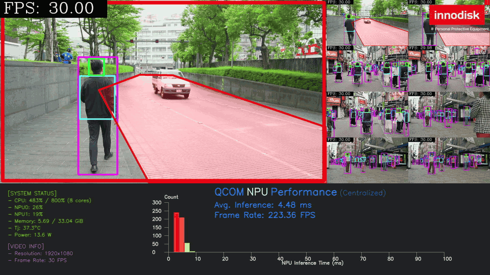
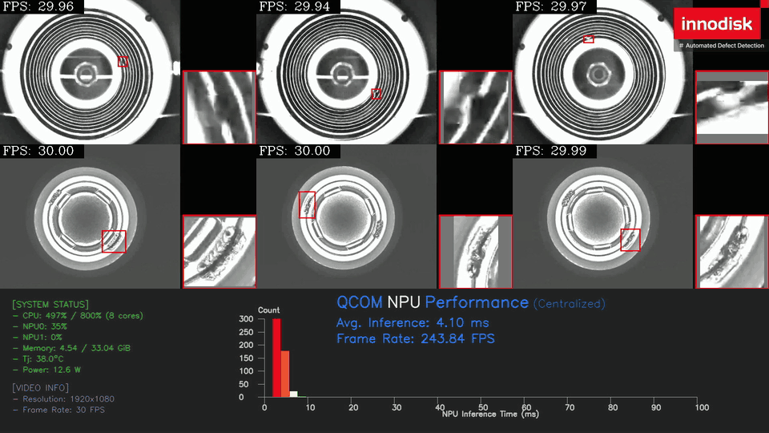
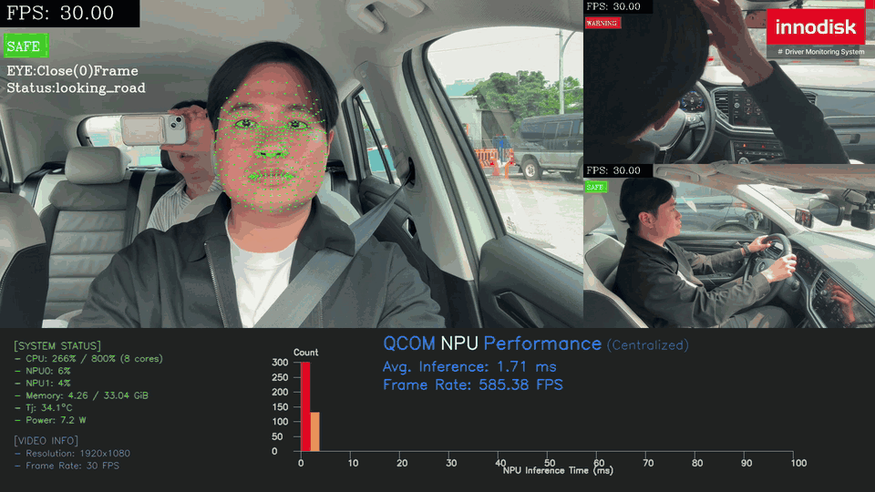

<!--
 Copyright (c) 2025 Innodisk Corp.
 
 This software is released under the MIT License.
 https://opensource.org/licenses/MIT
-->

# iQS-QVADK: How to Switch and Run the Applications

Please refer to the `tutorials/applications/iqs-qvadk` to learn how to run [iqs-qvadk](../../applications/iqs-qvadk/README.md).

In this section, we describe how to switch between the applications of iqs-qvadk and run each of them.

<br />
<div align="center"></div>
<br />

> Note: The latest iQ-Studio requires BSP 2.5.x (QLI 2.0). See the **Supported Versions** section of the [application tutorial](../../applications/iqs-qvadk/README.md).

## How to Deploy

1. For the video applications, no extra device is needed.
2. For the UVC camera application, at least one UVC camera
    - 1080p/30fps (1920x1080 pixels)
    - MJPEG compression format
    - For example, this Innodisk [USB camera](https://www.innodisk.com/en/products/camera/usb-20/ev2u-ssm1-rlcf).
3. For the GMSL camera application, at least one GMSL camera.
    - Download the camera driver package for your module (for the EV3F-ZSM1, `ev3f_zsm1_pp19`) from the [iQ-Cam release page](https://github.com/InnoIPA/iQ-Cam__manifest/tree/main/release).
    - To install and use a GMSL camera, please refer to the [iQ-Cam GMSL Camera Guide](https://github.com/InnoIPA/iQ-Cam__manifest/blob/v3.0.0/doc/common/gmsl.md).
    > Note: This demo has only been tested with the EV3F-ZSM1 camera.
4. For the PPE and DMS applications, download the SCRFD face detection model (and, for DMS, the face landmark model) first. See [Models You Need to Provide](./models/README.md).

## How to switch and run an application

iqs-qvadk provides three applications: **PPE**, **Defect detection** and **DMS**. PPE also has camera variants that take live input from a UVC or GMSL camera.

| Application | Channels | Models | Classes | Description | Preview |
| --- | :---: | --- | --- | --- | :---: |
| PPE | 9 | yolov26n, [scrfd](./models/README.md) | 5 (yolov26n), 1 (scrfd) | Runs PPE and ROI person detection on 9 streams. With face mosaic enabled, 18 models run at the same time. |  |
| Defect detection | 6 | yolov10n | 1 | Runs one independent YOLO model on each of 6 streams to detect screw defects on a production line. |  |
| DMS | 3 | [scrfd](./models/README.md), [landmark](./models/README.md#face-landmark), resnet18, resnet50 | 1 (scrfd), 1 (landmark), 2 and 3 (resnet18), 5 (resnet50) | Chains face, gaze, hand and body models on each of 3 driver streams (5 models in total) and shows a warning on high-risk behavior. |  |

> Note: The scrfd and landmark models are not included in iQ-Studio. Before running PPE (scrfd) or DMS (scrfd and landmark), download them by following [Models You Need to Provide](./models/README.md).

### How to switch

Run the commands from the iqs-qvadk directory (`cd tutorials/sdks/iqs-qvadk/`). Close the running application before starting another one.

>Note: The demo GIF may take some time to load. If it does not appear immediately, please wait.

#### PPE (default)

```bash
iqs-launcher --autotag iqs-qvadk
```


#### PPE with UVC camera

```bash
iqs-launcher --autotag iqs-qvadk --other "-c /workspace/configs/uvc/config_ppe_uvc.json"
```


#### PPE with GMSL camera

```bash
iqs-launcher --autotag iqs-qvadk --other "-c /workspace/configs/gmsl/config_ppe_gmsl.json"
```


#### Defect detection

```bash
iqs-launcher --autotag iqs-qvadk --other "-c /workspace/configs/videos/config_dd.json"
```


#### DMS

```bash
iqs-launcher --autotag iqs-qvadk --other "-c /workspace/configs/videos/config_dms.json"
```


